# Local Architecture

## Status and intent

Phases 0–6 implement configuration, schemas, data access, synthetic generation, graphs, tracing, risk, explanations, timelines, source-derived Fraud DNA, investigation summaries, evidence-linked review actions, PDF reports, and local demo reliability. The v0.7 React workspace separates cases, graph investigation, DNA, and summaries while sharing evidence and analysis state. Analysis is independent of HTTP, UI, storage format, hosting provider, and coding assistant.

## Components and data flow

```mermaid
flowchart LR
    Generator[Synthetic generator] --> JSON[Local JSON datasets]
    JSON --> Repository[Validated data access]
    Repository --> Analysis[Graphs, tracing, risk, DNA]
    Analysis --> Results[Shared analysis results and evidence]
    Results --> API[FastAPI routes and schemas]
    Results --> Reports[ReportLab reports]
    Reports --> API
    API --> Client[Typed frontend API client]
    Client --> UI[React panels and playback state]
    UI --> Graph[Cytoscape renderer]
```

### Backend boundaries

- `models/schemas.py`: validated source records. `models/analysis.py`: typed Phase 1 requests, responses, evidence, exact money, and bounded scores.
- `app/repository.py`: implemented JSON loading and validation, frozen records, read-only account/transaction indices, and dataset content hash. Future query helpers and database adapters should preserve this boundary. The loader does not consume the generator's campaign truth metadata.
- `engines/graph_builder.py`: transaction and entity graph projections, indices, and neighborhood queries.
- `engines/fraud_gps.py`: chronological trace and structural/temporal detections; retain transaction evidence, traversal limits, and reasons.
- `engines/risk_scorer.py`: normalized features, explicit weights, bounded scores, and cache lifecycle.
- `engines/fraud_dna.py`: implemented cross-case entity, behavioral, and topology comparisons, weighted signatures, inferred families, and factual identifier relations; independent from base risk to avoid circular dependencies. Bounded option-context caches belong to one dataset-scoped instance; `models/dna.py` holds the public contracts.
- `engines/explainer.py`: factual narratives and formatting from structured evidence; shared by tracing, summaries, and reports.
- `engines/investigation_summary.py`: case-scoped flagged accounts and deterministic review actions with source references. `models/reports.py` holds the shared summary and export request contracts.
- `engines/report_pdf.py`: ReportLab layout over shared summary results; bundled fonts, escaped source text, pagination, repeated tables, and no server-side report persistence.
- `engines/service.py`: dataset-scoped orchestration, default traces, cached risk/DNA, and shared graph/timeline/summary/report results.
- `routes/`: input validation, status codes, and response serialization. Keep reusable calculations outside routes, including report assembly as it grows.

Engines should accept data/context explicitly and return structured results without depending on FastAPI requests or frontend state. Load shared context during application startup. Key caches by dataset version and relevant query parameters; never reuse stale analysis after regeneration.

### Frontend boundaries

Implemented in Phase 2: `utils/api.ts` owns configurable Axios API access; `types/`
owns client contracts; `useGraphData`, `useTrace`, and `useRisk` manage requests and
cancellation. Components present results, and Cytoscape renders the backend's scores
and transfers. `GraphCanvas` is loaded separately to keep the initial bundle smaller.
`graphAnimations` owns cancellable timers and respects reduced-motion preferences.
Changing complaint or trace options clears previous evidence, expansion, selection,
and requests. See [Phase 2 contract](PHASE_2_CONTRACT.md) for search and view semantics.

Phase 3 adds `useTimeline` for independently retriable, cancellable timeline requests
and version/evidence checks. `usePlayback` owns event cadence, control state, and tab
visibility cleanup. Pure `utils/playback.ts` projects the event prefix; `GraphCanvas`
applies its classes without changing the graph topology. `graphAnimations` owns
cancellable transient effects. `StoryOverlay` tracks rendered node positions for
role labels and floating cards. `TimelineBar` and the sidebar dispatch the same
playback actions. Source-derived trail statistics are shared in trace responses.
See [Phase 3 contract](PHASE_3_CONTRACT.md) for step and pause semantics.

Phase 4 adds `useDNA` for separately retriable/cancellable reports, `types/dna.ts`,
pure source/score/provenance validation in `utils/dna.ts`, and Account Inspector/
Fraud DNA tabs. `DNAPanel` renders masked evidence, inferred families, matching
strength, behavior/topology, and real case/account navigation. `GraphData` has a
discriminated transaction/entity-link edge union; existing backend transaction
graph endpoints remain transaction-only. DNA report graphs carry separate relation
edges with no financial fields. Merge preserves original attributed transfers and
roles. Source relation inspection, filtering, highlight, hide/show, layout, and
replay honor edge kind. The pure dataset-version helper is shared by API, graph,
and DNA validation without importing browser HTTP configuration into tests.
See [Phase 4 contract](PHASE_4_CONTRACT.md) for inference and cache rules.

Phase 5 adds `useCaseSummary` with complete-trace/version checks and cancellable
requests; `useReportDownload` validates PDF responses and releases browser object
URLs. `CaseSummaryPanel` and `useReviewChecklist` keep review marks scoped to the
current trace. `AlertPanel` uses dataset-wide rankings and navigates through the
same selection/expansion path as search. `useNotifications` and its playback
adapter own bounded four-second timers and deduplication. Keyboard eligibility
is pure; the hook avoids native controls and dispatches existing playback/graph
actions. The three inspector tabs preserve the minimal, taller workspace.
See [Phase 5 contract](PHASE_5_CONTRACT.md).

Phase 6 adds evidence skeletons, exact integer-paise count-up with reserved widths,
reduced-motion-aware graph entrances, and safe notification stacking. Dense graphs
retain all edges while bounding animation work. The root Windows launcher uses a
standard-library Python preflight, builds the production frontend, polls readiness,
verifies reused app/version/dataset/build identity, and records process creation
times/paths for owned shutdown. See [the Phase 6 review](PHASE_6_REVIEW.md) for
measured local performance and [the demo guide](DEMO_GUIDE.md) for operation.

The modular redesign composes `CaseLibrary`, `TraceWorkspace`,
`ConnectionsWorkspace`, and `ReportWorkspace` from a small `App`. Shared
`useInvestigationWorkspace` owns the existing analysis hooks, selection, expansion,
playback, checklist, and report state. `useWorkspaceNavigation` handles hash routes
and browser history; keyboard navigation uses the same route actions. Page modules
remain mounted in hidden slots so navigation preserves review state and the graph
camera. `GraphCanvas` ignores zero-size observations, defers layouts while hidden,
and resizes without resetting an unchanged camera when reactivated. Leaving the
trail pauses playback and clears story notifications. Settings use a modal drawer
with focus trapping, Escape, and focus restoration; evidence inspection remains
contextual to the trail. Case/option changes still abort and clear obsolete evidence.

Launcher ownership stores the known executable path at process creation and checks
PID/path/start time before stopping its process tree. `backend/demo_process.py`
similarly stops the tree of a live owned `Popen` for smoke/benchmark commands on
Windows, covering virtual-environment redirector children. Other operating systems
use terminate/wait/kill. Neither helper enumerates or stops unrelated services.

## Contract rules

Phase 1 rules are finalized in [PHASE_1_CONTRACT.md](PHASE_1_CONTRACT.md) and the
[API guide](../fraud-gps/backend/API.md). The table below summarizes boundaries;
DNA contracts are finalized in [PHASE_4_CONTRACT.md](PHASE_4_CONTRACT.md).

| Concern | Rule |
| --- | --- |
| Identity | Stable internal account and transaction IDs; masking is display-only. Never use colliding last-four-digit labels as identity. |
| Transactions | Preserve every transaction between account pairs using a multigraph or indexed transaction store plus graph projection. |
| Money | Exact decimal/integer minor-unit arithmetic; specify API units explicitly. Avoid binary floating-point financial calculations. |
| Time | Timezone-aware ISO timestamps internally; Asia/Kolkata display, `DD-MMM-YYYY`, Indian currency grouping. Fix seed and reference date for reproducibility. |
| Trace | Return provenance transaction IDs, ordered steps, detected events, node roles, limits, and summary metrics. Specify chronology and attribution rules before coding. |
| Graph | Cytoscape-compatible `nodes` and `edges`; each edge has a unique ID and explicit transaction/entity-link kind. No implied transfer on an entity edge. |
| Risk | Score in [0,1], components, weights, level, role, confidence, evidence, and explanations. Define level boundaries centrally. |
| Timeline | Stable event ID, deterministic ordering/tie-break, event type, timestamp, referenced nodes and transaction IDs, display label. |
| DNA | Component scores, combined signature, campaign, linked entities/cases, method/version, and evidence references. |
| Errors | Consistent structured error response; distinguish invalid input, absent records, and valid empty results. |

Tracing uses a bounded chronological FIFO attribution hypothesis with explicit provenance and conservation of seed amounts. A graph reachability path alone is not proof that a specific victim's money funded every downstream transfer. Hop volume is separate from retained/stopped funds and cannot be interpreted as recovered or uniquely traced money.

## API inventory and dependency timing

| Phase | Planned endpoints |
| --- | --- |
| 0 (implemented) | `GET /health`, plus generated `/docs` and `/openapi.json`; startup validates all four datasets |
| 1 | `POST /api/trace`; `GET /api/risk/top`; `GET /api/risk/{account_id}` |
| 1 | `GET /api/graph/full`; `/api/graph/subgraph/{account_id}`; `/api/graph/trail/{complaint_id}`; `/api/timeline/{complaint_id}` |
| 1 | `GET /api/complaints`; `/api/complaints/{complaint_id}` — moved earlier as the Phase 2 prerequisite |
| 2 (implemented prerequisite) | `GET /api/accounts/{account_id}` — source details and measured inspector statistics |
| 4 (implemented) | `GET /api/dna/campaigns`; `/api/dna/entity/{account_id}`; `/api/dna/{complaint_id}` |
| 5 | `POST /api/report/{complaint_id}` returning a downloadable PDF |

Risk and DNA static routes precede dynamic account/complaint routes. Trace options
and summary exposure follow the API guide. Report summary and PDF endpoints are
implemented; they share structured results and enforce the requested dataset version.

## Local operation and future portability

Application root: `fraud-gps/`, with implemented `backend/` and `frontend/`. Backend
port 8000; Vite frontend port 3000. `app/config.py` implements backend-relative paths
and explicit local CORS origins. The frontend reads `VITE_API_BASE_URL`, defaulting
to `http://127.0.0.1:8000/api`. Seed/reference date remain generator CLI options.
See the [frontend guide](../fraud-gps/frontend/README.md) and
[data contract](../fraud-gps/backend/DATA_CONTRACT.md) for setup and record semantics.

Use JSON and in-memory NetworkX initially. No microservices, cloud SDKs, external model service, or PostgreSQL dependency is needed for the local phases. Record runtime versions and dependency pins during setup. Hosting adapters and operational controls can be added later behind the same boundaries.
